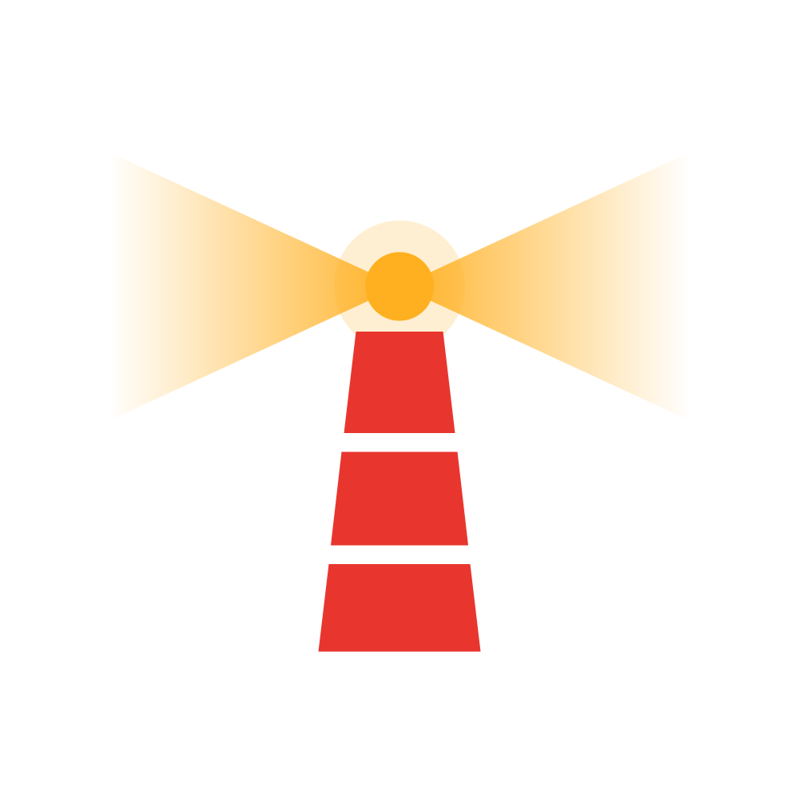

# Vigilia



**La emergencia, vista antes de llegar.** Puesto de mando asistido por IA para Bomberos. Platanus Hack 26: Santiago ft. Buk · team-17 · Track: 🌎 Physical World

- Nicolás Quintana ([@nicopad22](https://github.com/nicopad22))
- Alessandro Queirolo ([@aqm007](https://github.com/aqm007))
- Benjamín Taito ([@benjamintaito](https://github.com/benjamintaito))
- Lucas Cayazzo Cáceres ([@lcayazzo](https://github.com/lcayazzo))
- Agustín Alberto Arévalo Rodríguez ([@HechoEnChile](https://github.com/HechoEnChile))

## El problema

Cuando sale una emergencia, los bomberos van en camino sin saber con qué se van a encontrar: si hay personas atrapadas, dónde está el fuego, qué peligros hay y por dónde entrar. Los vecinos ya están grabando y la radio se llena de datos que nadie alcanza a cruzar.

## Qué hace

Vigilia suma al puesto de mando a **Vigía**, un agente de IA que trabaja como un integrante más: mira los videos y el dron, escucha la radio y le cuenta al oficial a cargo (OBAC) lo que pasa, para que él se concentre en decidir. Atiende una emergencia a la vez: la elegida en el tablero o, en «Automático», la abierta más nueva.

| Fuentes | Vigía (agente) | Mando |
|---|---|---|
| Video de vecinos por QR, cuadros del dron y la radio por Zello | Cruza las fuentes, cita de dónde sale cada dato y avisa lo nuevo cada 2 s | Ficha del OBAC, briefing en la tablet del carro y voz por Zello |

- **Vecinos** abren un enlace o un QR, sin crear cuenta, y envían videos o fotos. El navegador extrae fotogramas y los sube primero; el video original sube después. Vigía puede pedir más videos de una zona.
- **Dron en vivo**: un dron DJI transmite por RTMP (DJI Fly → MediaMTX → `tools/drone_bridge.py`) y el puesto de mando ve el video a 8 cuadros/s con las cajas de YOLOE (personas, bomberos, fuego, humo, gas, cables caídos) y una mirada de Claude cada pocos segundos. También hay simulador, un modo sensor con un teléfono y una referencia MAVLink.
- **Radio por Zello**: el puente `tools/zello-bridge` escucha el canal de todas las compañías, transcribe cada transmisión (ElevenLabs, con vocabulario de claves radiales) y la anota en la bitácora con su grabación.
- **El agente Vigía** (Claude con herramientas) revisa cada 2 s si hay algo nuevo, cruza las fuentes y habla en dos canales: la mesa de mando, con detalle, y la radio, solo cuando importa (posible persona en riesgo, riesgo nuevo, contradicción entre la radio y la imagen). Si el OBAC le pregunta por radio («Vigía, …») responde con voz en unos 4 s.
- **La ficha del OBAC** (`/mando/[id]`): mapa 3D con la casa por pisos, el foco, humo, zonas de peligro, conos de cámara y unidades con su ruta; personas, riesgos, unidades e historial de Vigía. Pestañas de esquema técnico y, con dron en vuelo, «Dron 3D»; el video del dron que transmite va en una ventana flotante abajo a la izquierda, intercambiable con el mapa.
- **3D de la escena**: mientras el dron vuela, nube de puntos en vivo con VGGT y, a pedido, Gaussian splats entrenados sobre ella (`vigia-live3d`, GPU L4); además, reconstrucción fotorrealista con 3D Gaussian Splatting a partir de todos los videos (job de Cloud Run con GPU).
- **Briefing en ruta**: vista para la tablet del carro, con lo crítico primero, lectura en voz alta y aviso cuando algo cambia.

### Reglas de la IA

Son reglas duras (`src/lib/vigia/rules.ts`): el agente no puede saltárselas y el código las aplica antes de mostrar o decir algo.

1. **Informa, no decide**: no da órdenes a las unidades ni dice por dónde entrar o si es seguro. Si algo hay que transmitir, lo propone y el OBAC decide.
2. **Confianza en cada dato**: alta, media o baja, siempre a la vista.
3. **Cita su fuente**: `M<n>` videos, `C<n>` radio, `D<n>` dron.
4. **«No se ve» no es «no hay»**: sin evidencia no descarta víctimas.
5. **Habla poco**: un mensaje por radio cada ~20 s, salvo posible persona en riesgo, y nunca encima de alguien con el PTT apretado.
6. **Nada simulado pasa por real**: sin IA configurada funciona igual, todo rotulado como simulado.

## Correr en local

```bash
npm install
npm run dev        # http://localhost:3000
```

Sin credenciales corre en **modo local**: datos en `.data/`, acceso abierto y motor de IA simulado (rotulado en la interfaz). Con `ANTHROPIC_API_KEY` en `.env.local` usa Claude de verdad. Todas las variables están en `.env.example`.

- Puente Zello: `npm run zello` (credenciales de Zello y ElevenLabs en `.env.local`; ver `tools/README.md`).
- Dron DJI en vivo: `tools/dron-dji.sh` (ver `tools/README.md`).
- Detector YOLO local: `detector/README.md`.

Pruebas: `npm test` · tipos: `npm run typecheck` · lint: `npm run lint`.

## Arquitectura

- Next.js 16 (App Router) + React 19, Tailwind CSS 4, three.js / React Three Fiber, MapLibre GL, Spark (Gaussian splats).
- Claude: análisis de medios con visión y salidas estructuradas, observador del video en vivo y el agente Vigía (`src/lib/vigia/`), que corre en el servidor en un ciclo de 2 s sin depender de un navegador abierto.
- Google Cloud Run (`southamerica-west1`) + Cloud SQL (Postgres 17) + Cloud Storage con URLs firmadas. Despliegue: `deploy/cloudrun.sh` (ver `deploy/README.md`).
- Servicios aparte: `vigia-detector` (YOLOE-26 + pose en CPU, privado), `vigia-zello` (worker pool con el puente Zello), `vigia-live3d` (VGGT y splats en vivo en GPU L4, `europe-west1`) y el job `vigia-splat` (3DGS en GPU, `europe-west1`, código en `gpu/splat/`).
- Datos en vivo por sondeo con un contador de revisión por incidente; el video en vivo del dron vive en memoria de la instancia (en la demo, una sola instancia).

| Ruta | Para quién |
|---|---|
| `/` | Portada |
| `/reportar` · `/reportar/[código]` | Vecinos: enviar un video (a una emergencia cercana o con su código) |
| `/mando` | Tablero: emergencias, mapa de la ciudad, emergencia en foco y demostración |
| `/mando/[id]` | Ficha del OBAC |
| `/mando/personal` | Cuentas del personal (admin) |
| `/en-ruta/[id]?k=…` | Tablet de la unidad en ruta |
| `/dron/[missionId]` | Teléfono usado como sensor del dron |
